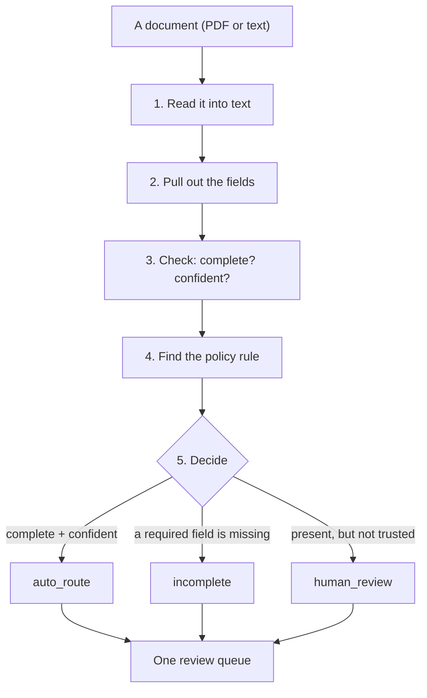

# Document Intake Triage

A public-benefits office receives a pile of unstructured documents — applications,
medical letters, ID proofs, income slips. Someone has to read each one, pull out
the key details, notice what's missing, and decide what to do next.

This project does that first pass automatically. It reads each document, extracts
the fields, checks them against the office's policy, and sorts everything into a
**review queue** with the reason attached to every item.

**It sorts and flags. It never decides who gets benefits.**

> **Looking for the plain-language overview?** There's a visual walkthrough for
> users at <https://telsangvi.github.io/doc-intake-triage/>. This README is the
> engineering side: how it works, and why it's built this way.

---

## The whole thing in one diagram



Five steps, one decision. Each step is a small module you can read on its own —
they're deliberately kept separate so you can change one without understanding
the others.

---

## Step by step

### 1. Read the file — `src/ingest.py`

Turns a file into plain text. PDFs go through `pypdf`; text and markdown are read
directly. One function, `read_document(path)`, so nothing downstream has to know
or care what format the input was.

*Why it's separate:* in the real world intake is messy — scans, exports, plain
text, multi-page PDFs. That messiness belongs in one place.

### 2. Pull out the fields — `src/extract.py` + `src/llm.py`

The text goes to a model, which returns a JSON object: the document type, the
fields it found, and a **confidence score for each field**.

Then `extract.py` coerces that JSON into a typed `Extraction` object. This is
deliberately defensive — models return slightly different shapes, and one odd
field should never crash the pipeline.

*Why it's separate:* the model is a component, not the system. Everything else is
written against one interface (`LLMClient`), so the model can be swapped without
touching the pipeline. See [The two seams](#the-two-seams-that-keep-it-swappable).

### 3. Check it — `src/validate.py`

Two independent questions, deliberately kept apart:

| Question | What it looks for | What happens if the answer is bad |
| --- | --- | --- |
| **Is it complete?** | Are the fields the policy requires actually present? | Goes back to the applicant |
| **Do we trust it?** | Is each value above the confidence threshold? | Goes to a human |

There are **two** confidence thresholds, not one:

- below `low` (default `0.60`) — the value isn't trustworthy at all, so flag it
- below `high` (default `0.85`) — present and plausible, but not good enough to
  auto-route

Both live in `src/config.py` and can be set by environment variable.

### 4. Find the rule — `src/retrieve.py`

A decision that says *"missing income"* is only useful if it can also say **which
rule** it applied. This step searches the office's policy corpus and attaches the
matching clause to the result:

```
- case_002_application.txt: Missing required field(s): monthly_income.
  Request from applicant. Applies 4.2(a) Requirement.
```

The policy documents live in `data/policy/` as markdown. They're split on `##`
headings, so every passage keeps its clause id — a citation without a clause id
isn't auditable.

### 5. Decide — `src/schemas.py`

The two checks above combine into one of three outcomes:

| Decision | Meaning | Where it goes |
| --- | --- | --- |
| `auto_route` | Complete, and every required field cleared the high threshold | Straight through |
| `incomplete` | A required field is absent | Back to the applicant |
| `human_review` | Everything present, but something isn't trusted | A caseworker looks |

---

## Why "missing" and "unclear" are different

This is the central design decision, and it's worth being explicit about it.

- A **missing** field is a problem with the applicant's paperwork. The fix is to
  ask them for it. That's a cheap, well-understood loop.
- An **unclear** field is a problem with the document itself — a bad scan,
  handwriting, or placeholder text where a value should be. The fix is a person
  looking at it. You cannot ask the applicant to re-send what they already sent.

Collapsing these into a single "needs attention" bucket is how intake systems end
up either nagging applicants for things they already provided, or quietly
guessing at values nobody can read. Separating them is what makes the output
usable without the system pretending to be certain.

---

## The two seams that keep it swappable

Two things in this system will always change: the model, and the way documents
are embedded for search. Both sit behind a small interface, with a fully offline
implementation as the default.

| Seam | Interface | Default (offline) | Real options |
| --- | --- | --- | --- |
| The model | `LLMClient.extract_document()` | `MockLLM` — regex-based | `OpenAILLM`, `AnthropicLLM` |
| Embeddings | `Embedder.embed()` | `HashingEmbedder` — bag-of-words | `OpenAIEmbedder` |
| Vector store | `.search(query, k)` | In-memory index | `SupabaseRetriever` (Postgres + pgvector) |

The payoff is that the project **runs with no API key and no network**. You can
develop, test, and demo it without an account, a budget, or a data-processing
agreement. Swapping in the real thing is a config change, not a rewrite.

**The mock is a stand-in, not a replacement.** Evals run green against it because
the gold set was written to match the sample documents — that proves the *harness*
works, not that the system is accurate on real data. Point it at a real model, or
at messier documents, and the scorecard will move. Watching it move is the point.

---

## How it's scored — `src/evals.py`

Three numbers, because there are three different things to get right:

```
doc-type accuracy: 100%    did we classify the document correctly?
decision accuracy: 100%    did we route it the way a human would?
field accuracy   : 100%    did we extract the right values?
```

The harness compares against `data/labels.jsonl` — a gold set of documents with
human-verified fields, classifications, and expected routing. Field-level misses
are printed by name; those are the next iteration.

`src/tuning.py` also sweeps the routing thresholds against the gold set and
reports **auto-route precision alongside decision accuracy**, because they trade
off. A conservative setting routes fewer documents but is rarely wrong — which is
usually what a public-sector customer actually wants.

```bash
python -m src.cli eval     # the scorecard
python -m src.cli tune     # the threshold sweep
```

---

## The policy corpus and the vector store

Retrieval runs **in memory by default** and needs nothing but Python. To back it
with a real vector store, the same interface is served by Postgres + pgvector:

```bash
# 1. apply the schema:  sql/001_triage_policy_passages.sql
# 2. point the app at your database and load the corpus
export RETRIEVER_BACKEND=supabase
export SUPABASE_DB_URL=postgresql://...      # from your dashboard
python -m src.cli load-policy
```

The schema puts the passages in a dedicated `triage` schema, separate from any
application tables, with row-level security on and no public policies. The search
function does cosine similarity over an HNSW index.

The connection string is read from the environment only — never hardcoded, never
committed. `RETRIEVER_BACKEND=memory` (the default) keeps everything offline, so
you can develop without a database and switch when you need one.

---

## Running it

```bash
pip install -r requirements.txt

python -m src.cli run data/samples              # process and print the queue
python -m src.cli eval                          # score against the gold set
python -m src.cli tune                          # sweep routing thresholds
python -m src.cli retrieve "income evidence"    # inspect the policy index
python -m src.cli export-ft                     # write a fine-tune dataset
python -m pytest -q                             # run the tests

uvicorn src.api:app --reload                    # then open http://127.0.0.1:8000
```

No API key is required for any of it. Containerised:

```bash
docker compose up --build
```

To use a real model, copy `.env.example` to `.env` and set
`DOC_TRIAGE_PROVIDER=openai` with your key.

---

## Project layout

```
doc-intake-triage/
├── src/
│   ├── config.py      # env-driven settings, safe defaults
│   ├── schemas.py     # the output contract + the office's required-field table
│   ├── llm.py         # provider-agnostic model client: mock | openai | anthropic
│   ├── ingest.py      # file -> text (pdf / txt / md)
│   ├── extract.py     # model output -> validated Extraction
│   ├── validate.py    # completeness + confidence -> decision
│   ├── retrieve.py    # policy index + retrieval (memory or Supabase/pgvector)
│   ├── load_policy.py # embed the corpus into the Supabase vector store
│   ├── pipeline.py    # orchestration: files in, review queue out
│   ├── evals.py       # the evaluation harness
│   ├── tuning.py      # threshold sweep, prompt variants, fine-tune export
│   ├── cli.py         # run / eval / tune / export-ft / retrieve / load-policy
│   └── api.py         # FastAPI service
├── app/index.html     # one-page review-queue UI
├── data/
│   ├── samples/       # 6 synthetic case documents
│   ├── policy/        # the office's policy corpus (retrieval source)
│   └── labels.jsonl   # the gold set the evals score against
├── sql/               # the pgvector schema
├── tests/             # routing, retrieval, and end-to-end tests
├── docs/              # the published user-facing walkthrough
├── Dockerfile
├── docker-compose.yml
├── .github/workflows/ # CI: tests + eval gate on every push
└── PROJECT_PLAN.md    # the engagement plan this code implements
```

---

## Extending it

**Add a document type.** Add it to `DocType` in `src/schemas.py`, add its
required fields to the `REQUIRED_FIELDS` table, and give `MockLLM` a few
classification keywords. Then add a sample and a label so the evals cover it.

**Add a model provider.** Write one class with an `extract_document()` method in
`src/llm.py`, and add it to `get_client()`. That's the whole change.

**Change the policy.** Edit the markdown in `data/policy/`, then re-run
`load-policy` if you're using the Supabase backend. The chunker picks up clause
ids from the `##` headings automatically.

**Change how strict the routing is.** Adjust `LOW_CONF_THRESHOLD` and
`HIGH_CONF_THRESHOLD`, or run `tune` to see the trade-off first.

---

## Design decisions, and why

- **Confidence is a first-class field.** Every value carries a score, so the
  system can say "I found it, but I'm not sure" instead of guessing.
- **Two thresholds, not one.** A value can be too unreliable to trust at all, or
  fine but not good enough to skip review. Those are different bars.
- **Fail toward a human, never toward a guess.** Anything uncertain routes to a
  person. A wrong auto-route is worse than no automation at all.
- **Every decision cites its rule.** The clause is stored with the result, so
  "why did this go back?" is answerable months later.
- **Offline by default.** A stand-in model and embedder mean zero setup, zero
  cost, and no credentials — which also makes the whole thing testable in CI.
- **The contract is the product.** The JSON shape in `schemas.py` is what the
  customer's case system consumes and what the evals score. The model is
  swappable; the contract is not.

---

## Notes

- All sample data is **synthetic** — no real personal or health information.
- If you adapt this to real records, treat them as sensitive from the start:
  data minimisation, access control, and no secrets in the repo.
- Built to be read. If a file is confusing, that's a bug — open it and fix it.
